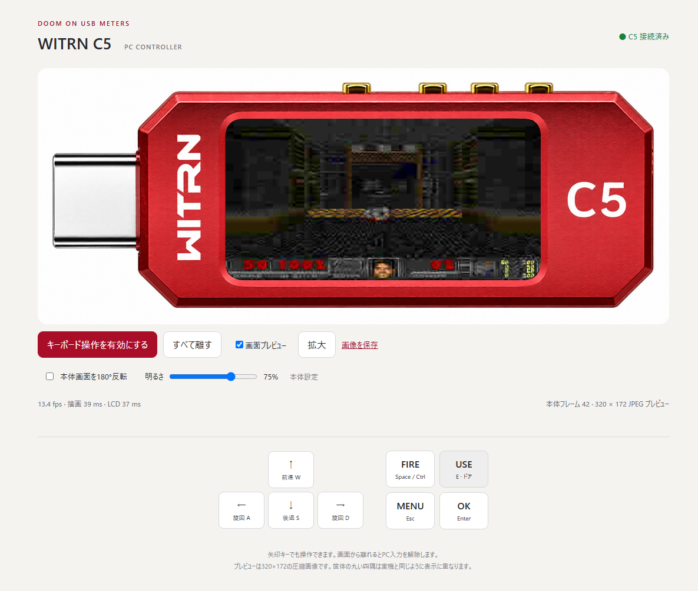
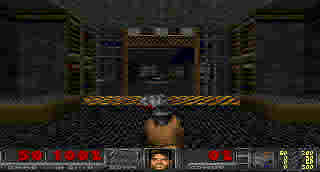

# APDO DOOM on WITRN C5

[English](README.md) · [導入手順](docs/INSTALL.ja.md) · [ビルド](docs/BUILD.ja.md) · [検証状況](docs/VALIDATION.ja.md)

USB電力計 **WITRN C5** で動作する、DOOMエンジンの移植です。
Freedoom 0.13.0のE1M1を、画像を軽量化した構成で収録しています。
インストールにはWindows PCが必要ですが、導入後はC5本体への給電だけでプレイできます。
PCからの操作・画面プレビューは任意です。

**現在の候補はネイティブ版v9.1／配布版 `0.1.0-rc.1` です。**
所有者の **C5 1台** で、本体プレイ、PCキー操作、JPEGプレビュー・拡大・保存、
本体画面の反転と明るさ変更を確認しました。HID状態と実機JPEGの受信も記録しています。
**Pre-release（候補版）** とし、長時間安定性、新たな全Flash監査、
この候補からの純正復帰は未確認です。
[確認できた範囲](docs/VALIDATION.ja.md)を参照してください。

*ホスト側のテスト表示です。実機キャプチャではなく、接続状態・FPSはテスト用の値です。*

*v9.1確認時、所有者のC5から実際に受信した320×172 JPEGです。*

## 機能

- ゲーム処理・マップ・素材を内蔵Flashに収録し、本体の4ボタンで操作。
- 320×172のLCD出力。ワールド部分は横160列、HUDは全幅で表示。
- ローカルPython HIDヘルパーを経由した、ブラウザーのキー／タッチ操作。
- 320×172のJPEGプレビュー、拡大表示、JPEG保存。
- 本体LCDの180度反転、バックライトの明るさ10～100％調整。
- Freedoomの起動バナー。表示設定はRAM内のみで、再起動時は通常向き・明るさ30％に戻ります。

プレビューは圧縮した静止画の連続取得です。表示FPSは本体のゲーム描画速度です。
このファームウェアは純正の計測アプリを置き換えます。計測・PD操作の画面は提供しません。

## 対象機と導入

所有者のC5に搭載された **2024年8月6日版ブートローダー** のLCD／USB関数を利用します。
機種名や純正ファームのバージョンが同じだけでは、互換性は確認できません。
読み取り専用のバックアップ・適合確認ツールで、ブートローダー先頭部分のSHA-256を照合します。
異なるC5ブートローダー、C4/C4L、他の電力計は適合確認の対象外です。

最初に[導入手順](docs/INSTALL.ja.md)と[復帰手順](docs/RECOVERY.ja.md)をお読みください。
公式WITRN更新ツールと純正ファームは別途入手します。
これらのメーカー配布物や、個体固有のFlashバックアップは公開ソースに含みません。

Windows用の確認キットには、`.c4ser`、対応ソース、PC操作、読み取り専用バックアップ・監査ツール、
英日手順、ライセンス、チェックサムを揃えています。
[v0.1.0-rc.1](https://github.com/inuchanbt/apdo-doom-on-c5/releases/tag/v0.1.0-rc.1)から取得できます。
安定版や、すべてのC5への互換性を保証するリリースではありません。

## 操作

| 操作 | 本体ボタン | PCキー |
| --- | --- | --- |
| 旋回 | 左／右 | A／D または ←／→ |
| 前進 | OK | W または ↑ |
| 後退 | — | S または ↓ |
| 発射 | 4つ目のボタン（PA14） | Space／Ctrl |
| ドア・スイッチ | 左＋右 | E |
| メニュー | OK＋4つ目のボタン | Esc |
| メニュー決定 | OK | Enter |
| メニュー移動・戻る | 左／右／4つ目のボタン | 矢印／Esc |

タブから離れた場合や入力の有効期限切れで、PC入力を解除します。
PC操作、モニター、メーカー更新ツールは同時に実行しないでください。

## ソースとライセンス

[ビルド手順](docs/BUILD.ja.md)には、ファーム・ホストテスト・素材再生成を記載しています。
ビルドに実機や個人のFlashダンプは不要です。
変更済みDMC100-Doomと、バージョンを固定したdoomgenericの入力ソースも収録しています。

組み合わせたファームウェアとソースは **GPL-2.0-or-later** です。
Freedoom素材は修正BSD、TinyJPEGなどの個別ライセンスは元の表記を保持します。
[LICENSE](LICENSE)、[COPYING](COPYING)、[第三者表記](THIRD_PARTY_NOTICES.md)を参照してください。
商用DOOMのWADは含みません。WITRN、id Software、Freedoomプロジェクトによる公式製品ではありません。
