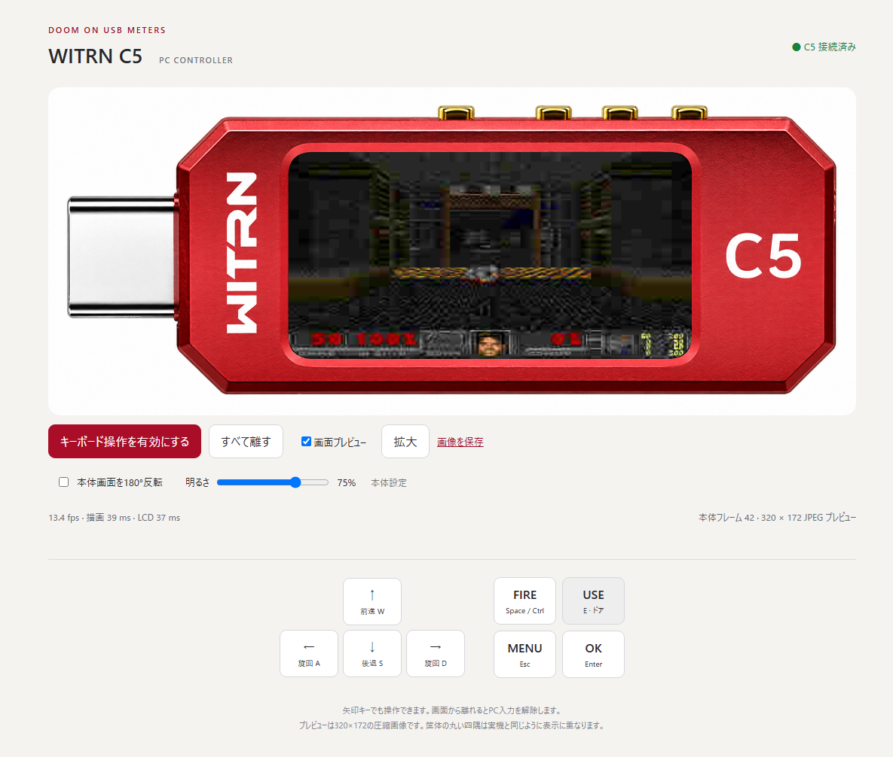
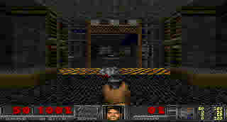

# APDO DOOM on WITRN C5

[日本語](README.ja.md) · [Install](docs/INSTALL.md) · [Build](docs/BUILD.md) · [Validation](docs/VALIDATION.md)

A native DOOM-engine port for the **WITRN C5 USB power tester**, running the
Freedoom 0.13.0 E1M1 level with reduced artwork. Once installed, the game runs
from the C5's internal Flash with power alone. A Windows PC is needed to install
it; PC controls and screen preview are optional during play.

**Current candidate: native v9.1 / package `0.1.0-rc.1`.** The owner confirmed
standalone gameplay, PC keyboard controls, JPEG preview/enlarge/save, physical
rotation and brightness on **one C5**. Live HID telemetry and JPEG reception were
also recorded. The owner subsequently restored **stock V8.5** and tried its
functions without observing problems. This is a **Pre-release**: long-duration
stability and a new full Flash preservation audit remain unverified.
See [the evidence and limits](docs/VALIDATION.md).

*Host-generated controller fixture, not a C5 hardware capture. Its status/FPS values are test data.*

*Actual 320×172 JPEG received from the owner's C5 during the v9.1 check.*

## Features

- Standalone local game logic, map and assets; four physical buttons.
- 320×172 LCD output, with 160-column world detail and a full-width HUD.
- Optional browser keyboard/touch controls through a local Python HID helper.
- 320×172 JPEG snapshots, preview enlargement and JPEG download.
- Physical LCD rotation by 180° and backlight adjustment from 10–100%.
- Original Freedoom startup banner. Display settings are RAM-only; power-on
  defaults are normal rotation and 30% brightness.

The preview is compressed snapshots, not a full-frame-rate video stream. The FPS
shown is the native game's frame rate. DOOM replaces the stock measurement
application; this firmware does not provide the meter's measurement/PD UI.

## Target and installation

This candidate uses private bootloader LCD/USB functions from the owner's C5
bootloader dated **2024-08-06**. Matching the model name or stock version alone
does not establish compatibility. The read-only backup/qualification helper
checks the bootloader prefix against the pinned SHA-256 before installation.
Other C5 bootloaders, C4/C4L, and other USB testers are not qualified targets.

Read [installation](docs/INSTALL.md) and [recovery](docs/RECOVERY.md) first.
The official WITRN updater and stock firmware are obtained separately; they
and all personal Flash backups are excluded from this repository.

A prepared Windows kit contains the `.c4ser`, matching source, controller,
read-only backup/audit tools, English/Japanese instructions, notices and checksums.
Download the candidate from [v0.1.0-rc.1](https://github.com/inuchanbt/apdo-doom-on-c5/releases/tag/v0.1.0-rc.1).
It is a pre-release, not a stable release or a claim of compatibility with every C5.

## Controls

| Action | Physical buttons | PC keyboard |
| --- | --- | --- |
| Turn | Left / Right | A / D or Left / Right |
| Move forward | OK | W or Up |
| Move backward | — | S or Down |
| Fire | Fourth button (PA14) | Space / Ctrl |
| Use door/switch | Left + Right | E |
| Menu | OK + fourth button | Esc |
| Confirm in menu | OK | Enter |
| Navigate/back in menu | Left / Right / fourth button | Arrow keys / Esc |

PC inputs release on tab blur or input expiry. Run only one controller, monitor
or vendor updater at a time. The existing browser UI uses Japanese labels;
the keyboard mapping and instructions above apply in either language.

## Source and licensing

[Build instructions](docs/BUILD.md) cover firmware, host tests and resource
regeneration. Builds do not require a device or anyone's private Flash dump.
The source includes the modified DMC100-Doom engine and pinned doomgeneric inputs.

The combined firmware/source is **GPL-2.0-or-later**; individual permissive
components retain their notices. Freedoom data uses its modified BSD license;
TinyJPEG retains its upstream public-domain/fallback license.
See [LICENSE](LICENSE), [COPYING](COPYING), and [third-party notices](THIRD_PARTY_NOTICES.md).
No commercial DOOM WAD is included. This independent project is not endorsed by
WITRN, id Software or the Freedoom project.
